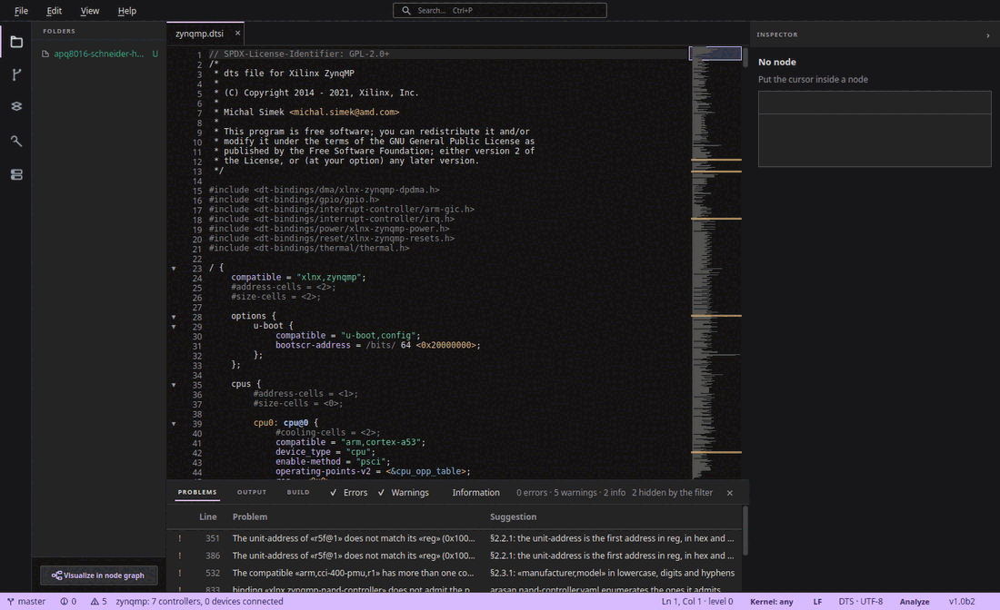

# KernelGrove — Device Tree Studio

A desktop editor for Linux Device Trees that understands what you are writing.
KernelGrove checks your `.dts`/`.dtsi` files as you type against the kernel's
own binding schemas, tells you what each `compatible` requires, draws the tree
as a graph, and helps you write, validate and compile overlays.



## Features

- **Semantic validation as you type**, in layers: the Device Tree
  specification, the generic bindings, the `dt-bindings/*.h` constants, the
  specific binding of each node, and overlay targets. A check only reports
  what its source states, and stays quiet when it cannot be sure.
- **Node inspector**: which properties a `compatible` accepts and which are
  required, with inheritance already resolved, and since which kernel release
  the binding exists.
- **Graph view** of the merged tree, including what the SoC `.dtsi` brings in;
  connect devices to buses from a palette of bindings that fit.
- **Hardware catalogue**: 3,600+ SoCs and boards and 25,000+ bindings,
  searchable.
- **Overlay assistant**: point at a node, pick what changes, and get a `.dtso`
  that is validated against its base before `dtc` compiles it.
- Completion driven by the bindings, go-to-definition for labels and
  `#include`s, `/delete-node/` and `/delete-property/` support, git integration,
  five skins (including high contrast and colour-blind friendly), English and
  Spanish UI.

## Install

Download the latest `.deb` (Linux x86_64) or Windows installer from the
[releases page](https://github.com/serg4life/kernelgrove/releases).
Versions 1.0b1–1.0b3 were published before the source was opened; their
installers and database are kept, archived, in
[serg4life/kernelgrove-releases](https://github.com/serg4life/kernelgrove-releases/releases).

```bash
sudo apt install ./kernelgrove_*.deb
```

The bindings database is downloaded on first run. Compiling needs `dtc` and a C
preprocessor: the `.deb` recommends `device-tree-compiler` and `cpp`, and the
Windows installer offers them as an optional component.

## Run from source

Requires Python ≥ 3.11.

```bash
git clone https://github.com/serg4life/kernelgrove.git
cd kernelgrove
python -m venv .venv && source .venv/bin/activate
pip install -e .
python -m kernelgrove
```

On Linux/X11, Qt needs `libxcb-cursor0` (`sudo apt install libxcb-cursor0`).
Without a display, use `QT_QPA_PLATFORM=offscreen`.

### Build the bindings database yourself

The database is generated from a Linux kernel checkout — its binding YAML
schemas, its `.dts`/`.dtsi` files and its `dt-bindings` headers — processed with
[dt-schema](https://github.com/devicetree-org/dt-schema):

```bash
pip install -e '.[ingest]'
git clone --filter=blob:none https://github.com/torvalds/linux.git kernel/linux
scripts/build_database.sh
```

See [`docs/ARCH-INGESTION.md`](docs/ARCH-INGESTION.md) and
[`docs/DT-SCHEMA-INTEGRATION.md`](docs/DT-SCHEMA-INTEGRATION.md).

## How it is built

Two pipelines share an internal model and a SQLite database: an offline
**ingestion** (`db_manager/`) that turns the kernel sources into
`bindings.db`, and the interactive **editor** — a parser and layered semantic
engine (`dts_engine/`), an API facade (`api/`) and a PySide6 GUI (`gui/`). The
architecture documents live in [`docs/`](docs/):

| Area | Document |
|---|---|
| Ingestion and database tables | [`ARCH-INGESTION.md`](docs/ARCH-INGESTION.md) |
| Semantic engine and check layers | [`ARCH-ENGINE.md`](docs/ARCH-ENGINE.md), [`SEMANTIC-ENGINE-FLOW.md`](docs/SEMANTIC-ENGINE-FLOW.md) |
| Overlays and building | [`ARCH-OVERLAYS-BUILD.md`](docs/ARCH-OVERLAYS-BUILD.md) |
| API, model and database distribution | [`ARCH-API-MODEL-DB.md`](docs/ARCH-API-MODEL-DB.md) |
| GUI | [`ARCH-GUI.md`](docs/ARCH-GUI.md) |
| Packaging | [`packaging/linux/README.md`](packaging/linux/README.md), [`packaging/windows/README.md`](packaging/windows/README.md) |
| Producing a release: prerequisites and checklist | [`RELEASING.md`](docs/RELEASING.md) |

Most internal documentation and code comments are written in Spanish; the UI
and diagnostics are in English.

## Contributing

Contributions are welcome — see [`CONTRIBUTING.md`](CONTRIBUTING.md) for the
setup, the tests and the conventions. Commits must be signed off under the
[Developer Certificate of Origin](https://developercertificate.org/), and
everyone taking part is expected to follow the
[Code of Conduct](CODE_OF_CONDUCT.md). Contributors are listed in
[`AUTHORS`](AUTHORS).

## License

KernelGrove is licensed under the [Apache License 2.0](LICENSE). You are free
to use, modify and redistribute it, commercially or not, as long as you keep
the license and the attribution in [`NOTICE`](NOTICE).

Third-party components keep their own licenses — see
[`src/kernelgrove/gui/LICENSES.md`](src/kernelgrove/gui/LICENSES.md). The
bindings database is derived from Linux kernel files and keeps their licenses
(mostly `GPL-2.0-only OR BSD-2-Clause`), and so does the kernel file used as a
test fixture (`tests/fixtures/zynqmp.dtsi`, `GPL-2.0+`, as its SPDX header
says).
